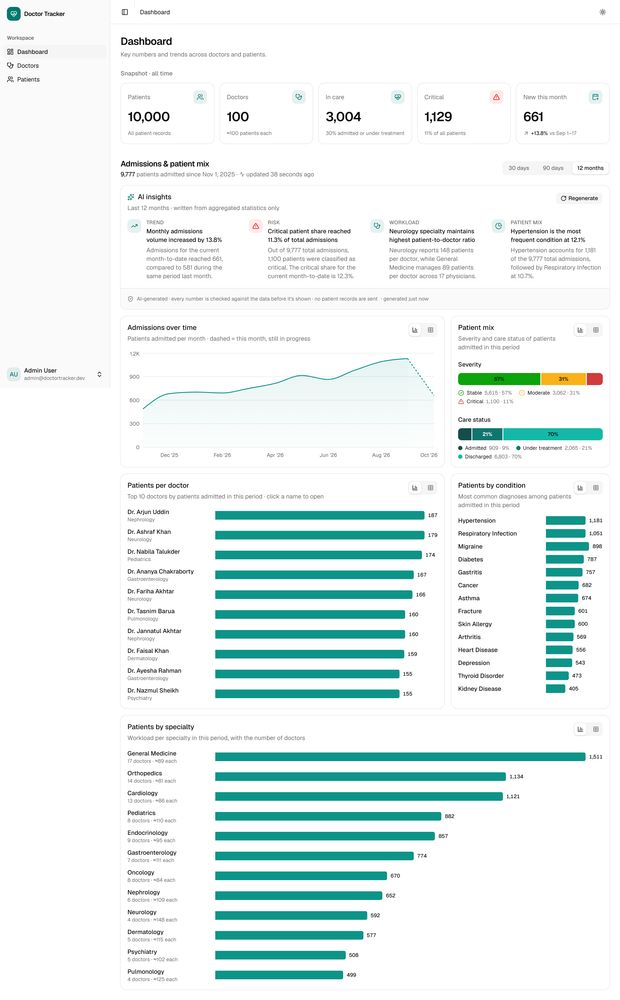
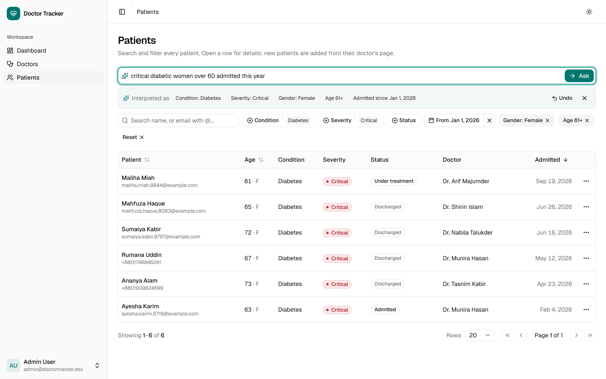
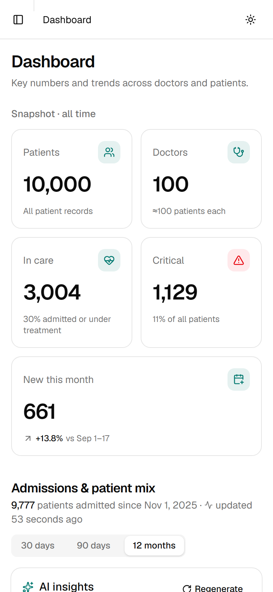
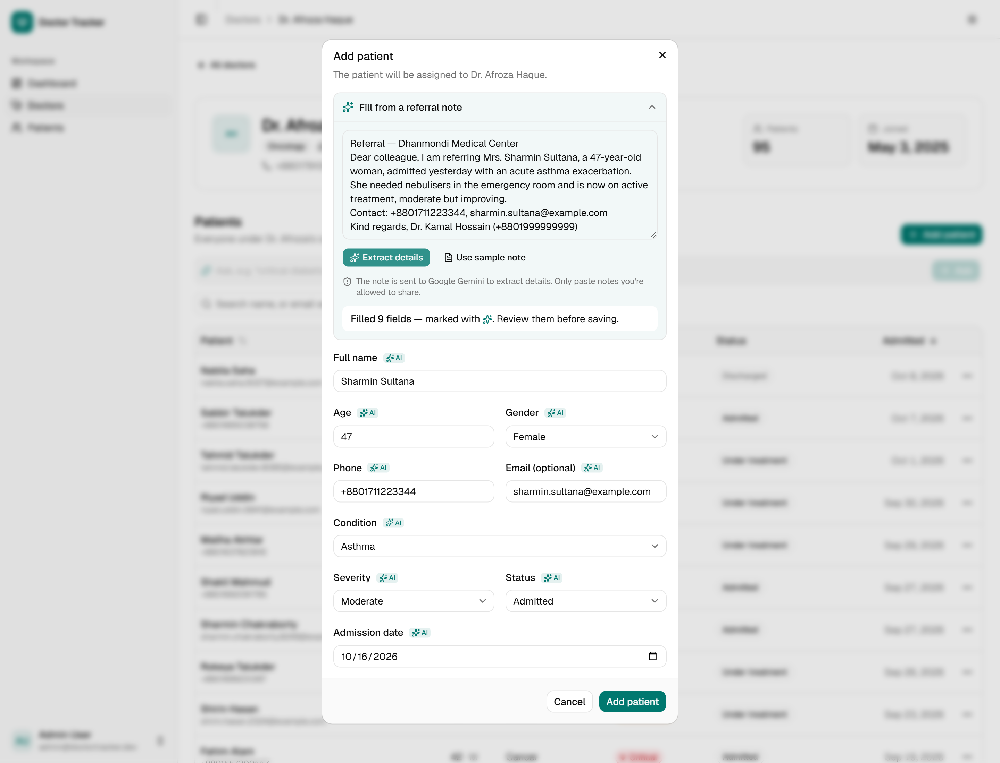
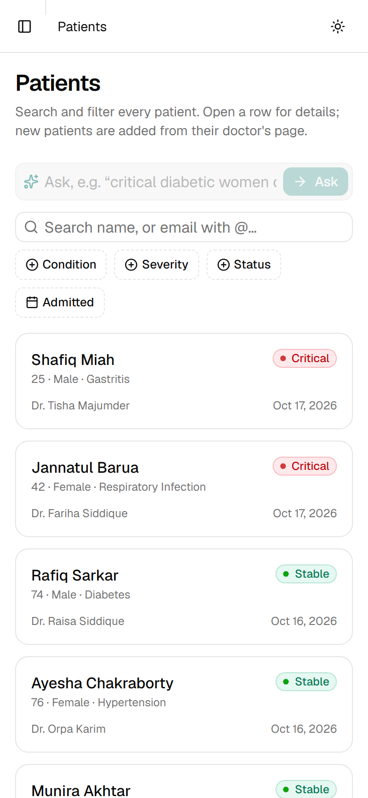
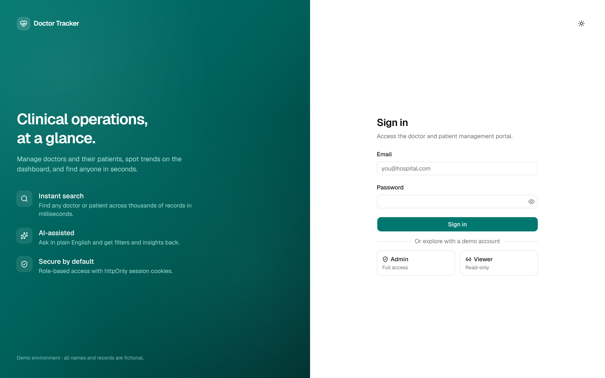
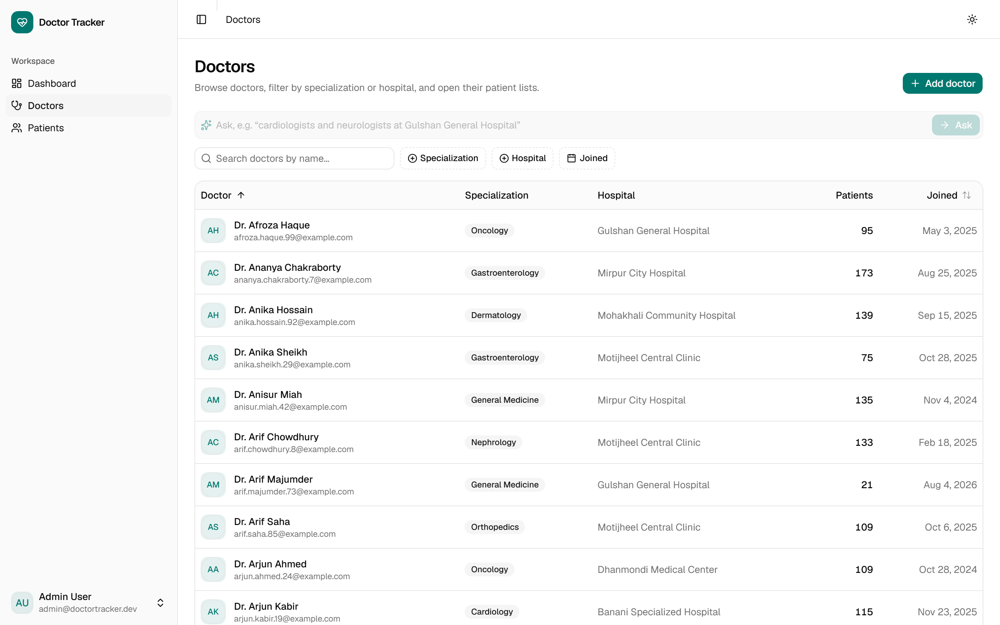
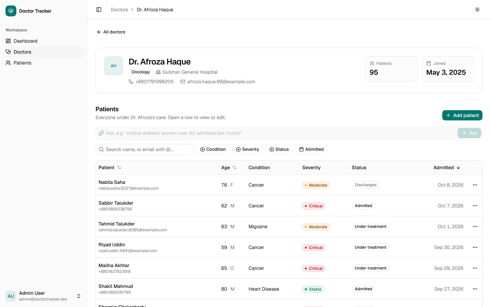
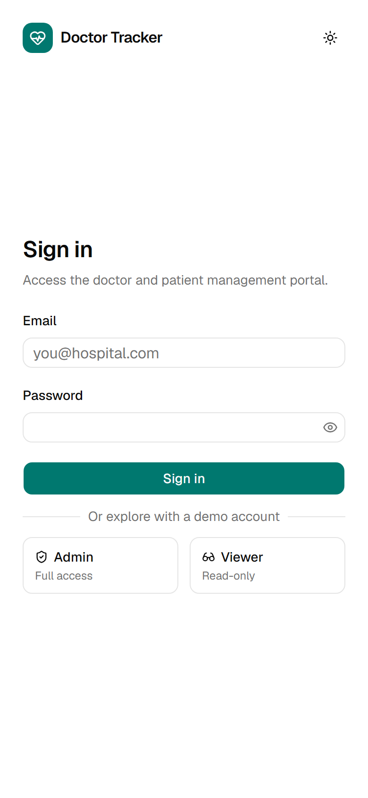
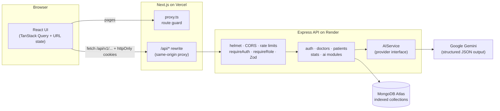

# Doctor Tracker — Frontend

**An AI-assisted doctor and patient management portal for hospital operations teams.** You can find any of 10,000 patients in milliseconds, ask questions in plain English ("critical diabetic women over 60 admitted this year") and get validated filters back, see admissions trends with AI insights that are checked against the data, and turn a pasted referral note into a pre-filled patient form for an admin to review.

| | |
|---|---|
| **Live app** | https://doctor-tracker-frontend-bay.vercel.app |
| **Live API** | https://doctor-tracker-api-x871.onrender.com/api/v1/health |
| **Backend repo** | https://github.com/Rza-O/doctor-tracker-backend |
| **Demo login** | Click **Admin** (full access) or **Viewer** (read-only) on the sign-in page |

> The API runs on Render's free tier, so the first request after it has been idle can take about 30–50 s while it wakes up.



<table>
  <tr>
    <td width="68%"></td>
    <td></td>
  </tr>
  <tr>
    <td></td>
    <td></td>
  </tr>
</table>

<details>
<summary>More screenshots: sign-in, doctors, doctor detail</summary>





</details>

---

## Features

**Authentication & roles**
- Email and password sign-in using httpOnly cookies. The session refreshes silently (15-minute access token, 7-day refresh token), and logout works on every device.
- **Admin** can create, edit and delete. **Viewer** is read-only. Controls a user can't use are hidden, and the API enforces the same rules.
- Logged-out users are sent to sign-in before any page renders (`proxy.ts`), and they land back on the page they asked for after signing in.

**Doctors**
- Paginated list with prefix search on any word of the name, filters for specialization, hospital and join date, sorting, and page size. All of it lives in the URL, so it can be shared and works with the back button.
- Add a doctor (admin). Click a row to open the doctor's page, which shows the profile, patient count and their patients with the same filtering tools.

**Patients**
- Global list with search by name, or email with `@`. Filters for condition, severity, status, admission date range, gender and age, plus sorting.
- Patients are added from their doctor's page. Click a row to open a side panel where you can view and edit. Delete is optimistic and asks for confirmation.
- On phones the table turns into cards.

**Dashboard**
- KPI tiles: patients, doctors, in care, critical, and new this month with the change from last month.
- A 30-day / 90-day / 12-month switch drives admissions over time (the current, incomplete period is drawn dashed), patient mix by severity and status, top 10 doctors, conditions, and workload by specialty.
- Every chart has a tooltip and a **table view**. Colors are checked for color-blind safety and contrast in light and dark mode, and status is never shown by color alone.

**AI (Google Gemini)**
- **Ask** on the Patients, Doctors and doctor pages. You get the filters it applied as chips, with one-click **Undo**, and it tells you which parts of the question it couldn't turn into a filter.
- **AI insights** on the dashboard: 2–5 observations about the selected period. Every number is checked against the data before it is shown.
- **Smart intake** in Add patient: paste a referral note and the form fills itself. Each filled field is marked ✨ AI until a person edits it, and nothing is saved automatically.
- With AI turned off on the server, all AI controls disappear and the app works fully with the manual filters.

**Polish**
- Light and dark themes, skeleton loaders, and empty and error states with retry.
- Accessible labels and keyboard support (shadcn/ui on Base UI).
- Security headers on every page.

---

## Tech stack

| Area | Choice |
|---|---|
| Framework | **Next.js 16** (App Router, Turbopack), **React 19**, **TypeScript** |
| Server state | **TanStack Query 5**: caching, next-page prefetch, `keepPreviousData` pagination, optimistic delete |
| UI state | The **URL** (`useListParams`) for every filter, sort and page |
| Forms | **react-hook-form** + **Zod 4**, with server field errors mapped back onto inputs |
| UI | **Tailwind CSS 4**, **shadcn/ui** (Base UI primitives), lucide icons, sonner toasts |
| Charts | **Recharts 3** through the shadcn chart wrapper |
| Hosting | **Vercel** (frontend) and Render (API) |

---

## Getting started (local)

**Prerequisites:** Node.js 22 (see `.node-version`) and the [backend](https://github.com/Rza-O/doctor-tracker-backend) running locally. Set that up first, including `npm run seed`.

```bash
git clone https://github.com/Rza-O/doctor-tracker-frontend.git
cd doctor-tracker-frontend
npm install
cp .env.example .env.local   # then edit, see below
npm run dev                  # http://localhost:3000
```

### Environment variables (`.env.example`)

| Variable | Purpose |
|---|---|
| `API_URL` | The Express API's base URL, e.g. `http://localhost:4000`. **Server-only.** `next.config.ts` reads it at build time for the `/api` proxy, so on Vercel set it before building. |
| `NEXT_PUBLIC_DEMO_ADMIN_EMAIL` / `_PASSWORD` | Optional. Shows the one-click **Admin** demo button. Use the seeded demo account (the same values as `SEED_ADMIN_*` in the backend). These values are public by design. |
| `NEXT_PUBLIC_DEMO_VIEWER_EMAIL` / `_PASSWORD` | Optional. Shows the **Viewer** demo button. |

Leave the demo variables empty to hide the buttons and sign in with the form.

### Scripts

| Command | |
|---|---|
| `npm run dev` | Dev server with Turbopack |
| `npm run build` / `npm start` | Production build and start |
| `npm run lint` | ESLint, including the React Compiler rules |

---

## Architecture



**How a request flows.** The browser only ever calls `/api/...` on the frontend's own domain. Next.js rewrites the request to the Express API, so auth cookies stay first-party. The API checks the JWT and the role and validates the input with Zod. Then it queries MongoDB using indexes designed for each screen, or calls Gemini with a strict JSON schema and validates the answer again before returning it.

### Folder structure

```
src/
├── app/                    # Routes only: thin pages that compose features
│   ├── login/
│   └── (app)/              # Authenticated shell: dashboard, doctors, doctors/[id], patients
├── features/               # One folder per domain: api.ts · hooks.ts · schemas · components/
│   ├── auth/  doctors/  patients/  stats/  meta/
│   └── ai/                 # Ask bar, insights card, intake panel, filter descriptions
├── components/
│   ├── ui/                 # shadcn/ui primitives
│   ├── data-table/         # Reusable table, toolbar, faceted & date filters, pagination
│   └── app-shell/          # Sidebar, header, breadcrumbs, user menu
├── hooks/                  # useListParams (URL state), useHydrated, useNow, …
├── lib/                    # api-client (envelope, errors, silent refresh), zod-resolver, formatting
└── proxy.ts                # Route protection (Next 16's middleware)
```

Feature folders keep everything for one domain together: API calls, query keys, hooks, schemas and components. Pages stay thin, and code is shared only when two features really need the same thing (the data-table kit, for example).

---

## Technical decisions

### 1. Server state in TanStack Query and UI state in the URL, with no Redux

**Context.** Almost all of the app's state is either *server data* (doctors, patients, stats) or *view settings* (filters, sort, page, period).

**Decision.**
- Server data lives in **TanStack Query**. Query key factories (`doctorKeys.list(params)`) give each filter combination its own cache entry.
- View settings live in the **URL** and are read through one `useListParams` hook, which parses the URL with a Zod schema.
- Only small local state (whether a dialog is open) uses `useState`.

**Why.**
- Query gives caching, deduplication, background refetch, `keepPreviousData` (no flash between pages), prefetching the next page, and optimistic delete with rollback. Building all of that in Redux would mean writing it myself.
- URL state makes every view shareable and bookmarkable, and the back button works. A reload keeps your filters. It also lets **Ask** work cleanly: the AI's filters are just a URL change, so Undo means going back to the previous URL.

**Trade-off.** URL parsing has to be strict. A hand-edited URL is validated, and bad values are dropped instead of crashing the page. Global client state would need something like Zustand, but this app has none.

### 2. httpOnly cookie auth through a same-origin proxy

**Context.** The frontend (Vercel) and the API (Render) are on different domains. Tokens kept in `localStorage` can be stolen by any XSS. Cross-site cookies are increasingly blocked by browsers and need CORS with credentials.

**Decision.**
- Tokens live in **httpOnly cookies**: a 15-minute access token, and a 7-day refresh token scoped to `/api/v1/auth`.
- The browser talks to the API **through a Next.js rewrite on its own domain**, so the cookies are first-party and `SameSite=Lax` is enough.
- On `401 TOKEN_EXPIRED`, `api-client` refreshes once and replays the request. If several requests fail at the same moment, they share a single refresh call.
- `proxy.ts` redirects logged-out users before anything renders.

**Why.** JavaScript can never read the tokens. There is no CORS setup in the browser and no third-party-cookie problem. The API URL never reaches the client. The route guard only checks that the cookie exists, because real verification happens on the API for every request.

**Trade-off.** Every API call makes one extra hop through Vercel, which adds a few milliseconds. A logout or role change takes effect at the latest when the access token expires (15 minutes). Logout also bumps a token version on the server, which kills refresh tokens immediately.

---

## AI integration

All three features follow the same pattern: **the model proposes, the code verifies, and a person decides.**

| Feature | What the model returns | What the code does with it |
|---|---|---|
| Ask | JSON filters from a closed schema (no queries, no free text) | Validates them again with Zod, tidies them (drops impossible ranges and future dates), applies them as URL params, and shows them as chips with Undo |
| Insights | 2–5 `{kind, title, detail}` items, written from **aggregated statistics only** | Drops any insight that quotes a number or percentage not in the input data, caches for 10 minutes, and offers Regenerate |
| Smart intake | Patient fields found in a referral note | Checks phone, email and dates on the server. It only pre-fills the form, marks each field ✨ AI until edited, and never submits |

The model is chosen by measured latency and reliability. A failed call is retried, then sent to a fallback model, with an 8-second timeout per attempt. An eval script (`npm run ai:eval` in the backend) checks Ask on 17 test cases. More detail is in the [backend README](https://github.com/Rza-O/doctor-tracker-backend#ai-layer).

### Privacy trade-off (please read)
- This demo uses the **free tier of the Gemini API, where Google may use prompts to improve its products.**
- **Ask** sends the question text, and **Smart intake** sends the pasted note. **Insights** send only aggregated counts and never patient records.
- The intake panel warns users before they send. All data in this demo is fictional.
- For real patient data I would use a paid or enterprise tier with no training on customer data and a signed data processing agreement (DPA, or a BAA in the US). I'd also redact identifiers before sending, and keep AI behind a per-organisation setting. The app already runs fully without AI (`AI_PROVIDER=none`).

---

## Trade-offs & what I'd do next
- **Search:** word-prefix search on an indexed token array is fast and simple. At larger scale I'd move to Atlas Search for typo tolerance.
- **Pagination:** offset pagination fits "jump to page N" for this dataset size. For very large lists I'd add cursor pagination.
- **Tests:** I verified every milestone with scripted browser runs and API checks. Next I'd commit a Playwright suite and unit tests for the URL schemas, and run them in CI.
- **Product:** an audit log of who changed which patient, CSV export of a filtered list, and patient notes and timeline.
